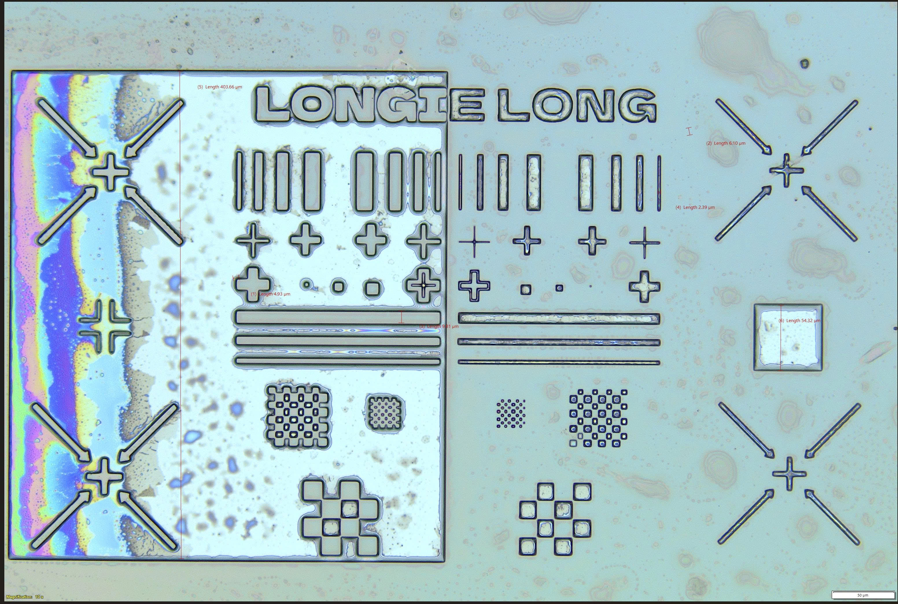

  
  
  # Hi there 👋, I'm Cao Long
  
  *University student and researcher based in Vietnam, knee-deep in Semiconductors, IoT, and the occasional CTF.*

---

## 🔬 What I'm Working On
* **Embedded Hardware:** Designing and prototyping an Electronic Nose (E-Nose) gas sensor platform.
* **Firmware & Software:** Writing register-level C/C++ firmware for STM32 and developing desktop app for graphing data.
* **Academic Research:** Investigating metal oxide semiconductor gas sensors and 2D material field-effect transistors. 
## 🛠️ Tech Stack & Tools

---

**Languages & Software Development**

---

**Hardware & Embedded**

---

**Design, Data & OS**

* **Tools:** OriginPro (Data fitting/IV curves), FreeCAD, VS Code (WSL2 env)

---

## 📊 GitHub Stats

  <picture>
    <source media="(prefers-color-scheme: dark)" srcset="https://raw.githubusercontent.com/0Gd3v/0Gd3v/output/github-contribution-grid-snake-dark.svg">
    <source media="(prefers-color-scheme: light)" srcset="https://raw.githubusercontent.com/0Gd3v/0Gd3v/output/github-contribution-grid-snake.svg">
    
  </picture>

